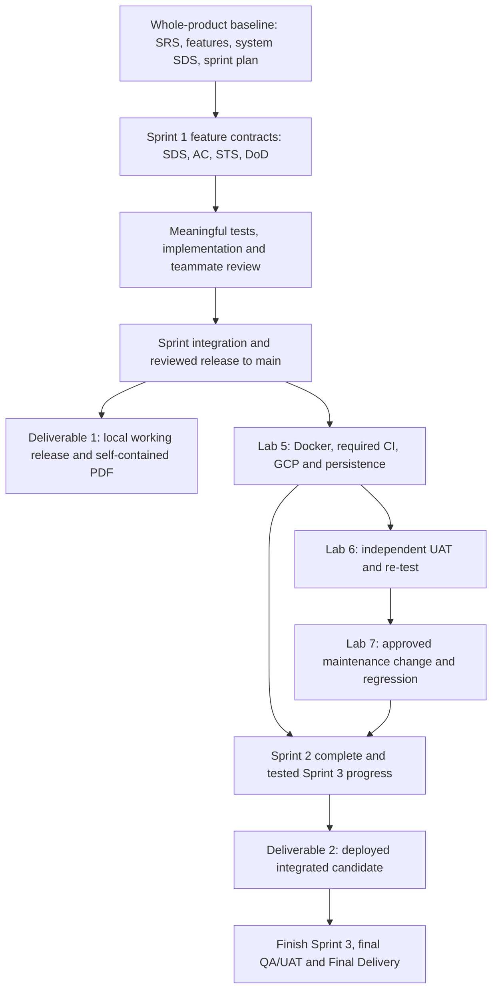

# PocketLedger — CPE334 Group Project

จุดเริ่มต้นของ PocketLedger ตั้งแต่ Deliverable 1 ผ่าน Labs 5–7, Deliverable 2 และ Final ใช้ทีม แอป และ product repository เดียวกันตลอดโครงการ เอกสารในโฟลเดอร์นี้เป็นใบงาน/ไฟล์เตรียมงานใน **course repository** ส่วนโค้ดอยู่ใน independent checkout `project/pocket-ledger/` ซึ่ง course Git ignore ทั้งโฟลเดอร์

## ทีมและหัวข้อที่ยืนยันแล้ว

| สมาชิก | Student ID | GitHub |
| --- | --- | --- |
| Wisit Suwannao | 67070501042 | Palapluem |
| Natthawat Primsirikunawut | 67070501027 | N0TAW00D |

หัวข้อที่เลือกตามคำยืนยันของทีมเมื่อ 3 พฤศจิกายน 2026 คือ **Theme 7: Personal Money and Expense Logging System** เลือกได้จากรหัสนักศึกษาของ Natthawat ที่ลงท้ายด้วย 7 ตาม master specification §6

ผู้เรียนเลือกชื่อ **PocketLedger** และ repo **[Palapluem/pocket-ledger](https://github.com/Palapluem/pocket-ledger)** แล้ว ชื่อกลุ่มใน LEB2 คือ **2-Nor** ตามคำยืนยันวันที่ 7 พฤศจิกายน 2026 ส่วน section/เลขกลุ่มแยก, stack และ financial policies ยังรอทีมยืนยัน ขณะนี้มีร่าง baseline และ Sprint 1 contracts/STS ให้ทีม review แต่ยังไม่มี accepted Sprint 1 release

สำหรับแผนแบ่งงานและสถานะล่าสุดของ PD1, Lab 5 และ Lab 6 ให้เริ่มที่ [Team Work Plan](TEAM_WORK_PLAN_PD1_LAB5_LAB6.md) แล้วกลับมาใช้ handout ต้นฉบับตัดสินข้อกำหนดและคะแนน

## แยกสอง repo อย่างไร

| ที่เก็บ | เก็บอะไร | อัปเดตอย่างไร |
| --- | --- | --- |
| CPE334 course repo (โฟลเดอร์นี้) | ใบงาน/lecture, preparation, report templates และ PDF ฉบับส่ง | commit/push material/report change ที่ตรวจแล้วใน course Git |
| `project/pocket-ledger/` → `Palapluem/pocket-ledger` | canonical product specs/contracts, code, tests, migrations, config/workflows และ release records | Issue → feature/fix/docs branch → teammate-reviewed staging PR → integration → reviewed main release |
| `_private/pocket-ledger/` | raw logs/evidence/temporary work ที่ต้องเก็บเฉพาะเครื่อง | course ignore; สร้างเฉพาะเมื่อมีงานจริงและลบ temp เมื่อจบ |

Nested checkout ไม่ใช่ submodule ห้าม force-add หรือ push source จาก PocketLedger เข้า CPE334 ก่อนทุก Git write ให้ตรวจ root/remote/status ของ repo ที่ตั้งใจ ดู [workspace rules](../AGENTS.md) และ [product contribution rules](https://github.com/Palapluem/pocket-ledger/blob/main/CONTRIBUTING.md)

เอกสารวิศวกรรมฉบับหลักอยู่ใน product repo: docs/decisions.md, srs.md, features.md, traceability.md, system-sds.md และ docs/sprints/ **PR #4 merge เข้า `sprint-1-staging` แล้วเมื่อ 8 พฤศจิกายน 2026** โดยเพิ่มเอกสารเท่านั้น; ไม่ได้เพิ่ม application source, tests หรือ accepted release. ณ 11 พฤศจิกายน `main` ยังอยู่ที่ bootstrap `a4cced2`, `sprint-1-staging` อยู่ที่ `ff2143a`, ไม่มี PR เปิด และ Issues #1–#3 ยังเปิดอยู่. ตรวจสถานะสดจาก [GitHub](https://github.com/Palapluem/pocket-ledger) ก่อนเริ่มงานเสมอ

แหล่งทำรายงานที่ผู้เรียนกำหนดคือแท็บ [Project Deliverable 1](https://docs.google.com/document/d/1LvDrVanne23Pgj6LH7AoiacwpgOu-sGl7Hyr6pycZCo/edit?tab=t.241qhfcdhce3), [Lab 5](https://docs.google.com/document/d/1LvDrVanne23Pgj6LH7AoiacwpgOu-sGl7Hyr6pycZCo/edit?tab=t.s9umabyrevqi), [Lab 6](https://docs.google.com/document/d/1LvDrVanne23Pgj6LH7AoiacwpgOu-sGl7Hyr6pycZCo/edit?tab=t.uhs47dish96h) และ [Project Deliverable 2](https://docs.google.com/document/d/1LvDrVanne23Pgj6LH7AoiacwpgOu-sGl7Hyr6pycZCo/edit?tab=t.amnwb9uwd0u0) ใน Google Doc เดียวกัน จัดทำ PDF ผ่าน Print หลังเนื้อหาและหลักฐานพร้อม และอย่าใช้ผลหรือภาพ TokTickIT เป็นหลักฐาน PocketLedger ตรวจแท็บ Lab 6/PD2 ให้มีเนื้อหาของงานนั้นจริงก่อนใช้; การเปลี่ยนชื่อแท็บอย่างเดียวไม่พอ

## อ่านและทำตามลำดับนี้

1. อ่าน [decision register](https://github.com/Palapluem/pocket-ledger/blob/sprint-1-staging/docs/decisions.md), Issues #1–#3 และร่าง baseline บน `sprint-1-staging`; ร่วมกันยืนยัน stack/กติกาการเงิน/session/interfaces/ขอบเขต Sprint 1 ที่ยังเปิดอยู่
2. ใช้ [คู่มือเตรียม Deliverable 1](Project%20Deliverable%201/README.md) สร้าง baseline ของทั้งผลิตภัณฑ์และ contract ของ Sprint 1 ก่อนเริ่ม implementation
3. ใช้ [แม่แบบ feature contract](Project%20Deliverable%201/feature-contract-template.md) กับฟีเจอร์ที่กำลังจะทำ และใช้ [โครงรายงาน Parts A–F](Project%20Deliverable%201/report-outline.md) เก็บตำแหน่งหลักฐานตั้งแต่ต้น
4. ส่ง working Sprint 1 ที่ผ่าน review และ integration บน `main` ก่อนนำ release นั้นไปทำ [Lab 5](../labs/Lab05/README.md)
5. ทำ [Lab 6](../labs/Lab06/README.md), [Lab 7](../labs/Lab07/README.md), [Deliverable 2](Project%20Deliverable%202/README.md) และ [Final Delivery](Final%20Delivery/README.md) ต่อจาก product/release เดิม โดยแยก assessment evidence ให้ตรวจได้

## เอกสารต้นทาง

| เอกสาร | ใช้ตัดสินเรื่องใด |
| --- | --- |
| [Group Work Specification](group_work_specs_v1.pdf) | ทีม 2 คน, Theme 7 (PDF หน้า 7–8), baseline ทั้งผลิตภัณฑ์, SDD/TDD/Git และความต่อเนื่องของโครงการ |
| [Project Deliverable 1](Project%20Deliverable%201/project_deliverable_1_v1.pdf) | ข้อกำหนด Sprint 1 และการส่ง PDF Parts A–F แบบ self-contained |
| [Project Deliverable 2](Project%20Deliverable%202/project_deliverable_2_v1.pdf) | งานส่งรอบ Sprint 2 และความคืบหน้า Sprint 3 |
| [Final Delivery](Final%20Delivery/project_final_delivery_v1.pdf) | งานส่งและการตรวจผลิตภัณฑ์ฉบับสุดท้าย |
| [Lab 5 handout](../labs/Lab05/01_SE_Lab_5_updated.pdf) | R-01–R-12, C-01–C-06, rubric และข้อกำหนด GCP ของ Lab 5 |
| [Student Guide V1.1](../labs/Lab05/03_Student-Guide-GCP-Deployment-and%20CI%20CD-V1_1.pdf) | ขั้นตอน Episodes 0–10; ปรับคำสั่งและชื่อ resource ให้ตรงกับแอปจริง |
| [Lecture 11](../lectures/Week%2011/CPE334_Lecture11%20-%20Cloud%20Deployment%20and%20Delivery%20to%20Users.pdf) | SDD หน้า 8; commit → image → revision หน้า 36; workflow นักศึกษา หน้า 37; deployment/smoke หน้า 40–41 |

PDF ทั้งสี่ไฟล์ใน `project/` ตรงกับสำเนาที่มากับ Week 10 ทุกไบต์ จึงเป็นการจัดหมวดใหม่ของเอกสารเดิม ไม่ใช่ handout ฉบับปรับปรุงใหม่ เก็บสำเนา Week 10 ไว้เพื่อรักษาชุดเอกสารการเรียนและลิงก์เดิม

**จุดต่างของแหล่งข้อมูลที่ต้องระวัง:** master PDF ระบุ “Draft for instructor review” และ Deliverable 1 อ้าง `group_work_specs.docx` ซึ่งยังไม่มีในชุดไฟล์นี้ ใช้ handout ราย assessment สำหรับรายละเอียดการส่งของงานนั้น โดย Deliverable 1 §4 ให้ใส่เอกสารวิศวกรรมครบใน PDF แม้ master §9 จะกล่าวถึง evidence index แบบกระชับ หากมีประกาศหรือ master ฉบับอนุมัติใหม่ ให้เทียบความต่างก่อนปรับ baseline

Lab 5 §6 ให้ยึด handout เมื่อขัดกับคู่มือหรือ starter kit และ Lecture 11 หน้า 37 กำหนด workflow นักศึกษาแบบ feature → reviewed staging PR → integration → reviewed release PR → main การสาธิตของ TA ที่เข้า `main` โดยตรงใช้แทนข้อกำหนดนี้ไม่ได้

## กำหนดส่งจากเอกสารที่มีอยู่

| งาน | กำหนดส่ง | คะแนน / น้ำหนักรายวิชา |
| --- | --- | --- |
| Deliverable 1 | 8 พ.ย. 2026 เวลา 23:59 ตาม handout | 80 / 8%; ผู้เรียนแจ้งว่าเลื่อนเป็น 14 พ.ย. ให้ยืนยันประกาศทางการ |
| Lab 5 | 15 พ.ย. 2026 เวลา 23:59 | 100 / 5% |
| Lab 6 | 22 พ.ย. 2026 เวลา 23:59 ตาม master schedule | 100 / 5% |
| Deliverable 2 | 29 พ.ย. 2026 เวลา 23:59 ตาม handout §4 | 70 / 7% |
| Lab 7 | 29 พ.ย. 2026 เวลา 23:59 ตาม master schedule | 100 / 5% |
| Final Delivery | 13 ธ.ค. 2026 เวลา 23:59 ตาม handout §4 | 100 / 10% |

ตรวจประกาศ LEB2/อาจารย์ประกอบก่อนส่ง ผู้เรียนแจ้งว่า PD1 เลื่อนเป็น 14 พ.ย. แต่ Lab 5 handout ยังระบุ 15 พ.ย.; ยืนยันว่า Lab 5 เลื่อนตามหรือไม่. Lab 6 handout มีอยู่ใน `labs/Lab06/`; Lab 7 ยังต้องตรวจ handout/ประกาศฉบับละเอียดก่อนวางแผนส่ง

อ่าน handout Deliverable 2 และ Final ครบแล้ว Final §2 กับ §3.5 ขัดกันเรื่องวิดีโอไม่เกิน 10/4 นาที อีกทั้ง master แบ่งคะแนน video/release-summary ต่างจาก Final handout ให้เก็บ instructor clarification ก่อนบันทึกวิดีโอ โดยใช้ [Final preparation](Final%20Delivery/README.md) ติดตามประเด็นนี้

## สกิลที่ใช้และจังหวะใช้งาน

สกิลเป็นเครื่องมือช่วยทำงาน ไม่ใช่ requirement เพิ่มของรายวิชา และไม่มีผลแทนหลักฐานจากแอปจริง

| สกิล | ใช้ทำอะไร | รอบนี้ |
| --- | --- | --- |
| `pdf` | อ่าน rubric, ตาราง, ข้อยกเว้น และตรวจ PDF เมื่อเริ่มทำรายงาน | อ่านเอกสารต้นทาง |
| `thai-study-assistant` | อธิบายข้อกำหนดเป็นไทยโดยรักษา required/recommended และเงื่อนไข | ใช้เขียนคู่มือเตรียมงาน |
| `wayfinder` | ใช้เฉพาะเมื่อผู้เรียนพิมพ์ /wayfinder โดยตรง | ไม่เรียกอัตโนมัติ; งานปัจจุบันใช้ decision register เดียวและ sprint plan |
| `domain-modeling` | แยกศัพท์การเงินที่สับสนและบันทึกความหมายให้ตรงกัน | ใช้ [product GLOSSARY](https://github.com/Palapluem/pocket-ledger/blob/main/GLOSSARY.md) |
| `tdd` | วาง expected results และจุดทดสอบ behavior ก่อนทำทีละ slice | เตรียมแนวทดสอบ; ยังไม่เขียนหรือรันทดสอบแอป |
| `code-review` | ตรวจ diff เทียบมาตรฐานและ contract เมื่อมี implementation/PR จริง | ใช้เมื่อถึงรอบ review |
| `agent-browser` | ตรวจ UI และ user journey จริง รวมถึง smoke/persistence evidence | ใช้เมื่อมีแอปที่รันได้ |
| `google-drive:google-docs` | อ่านหรือแก้เฉพาะแท็บ assessment ที่ผู้เรียนระบุและอนุญาต | ใช้ rubric ของงานนั้น; เว้นหลักฐานที่ยังไม่เกิดขึ้น และ export ผ่าน Print เมื่อผู้เรียนสั่ง |
| `supabase-postgres-best-practices` | ตรวจ schema/query/transaction เมื่อทีมเลือก PostgreSQL | ใช้เมื่อเริ่มออกแบบหรือแก้ฐานข้อมูล |

ไม่ต้องเรียกสกิลของบริการหรือเทคโนโลยีที่ทีมไม่ได้ใช้ และไม่เพิ่ม Kubernetes, microservices, external bank integration หรือ quota ของ UML/test/commit ที่ใบงานไม่ได้กำหนด

## กติกาทำงานต่อ

- ทั้งสองคนร่วม requirements/design, testing, implementation, supervision, review และ delivery สลับผู้ทำกับผู้รีวิวตามงาน ไม่แบ่งถาวรว่าคนหนึ่งเขียนเอกสาร อีกคนเขียนโค้ด
- ใช้ Issue ที่อ้าง feature/contract, branch จาก sprint staging, review แบบระบุสิ่งที่ตรวจ และ release เมื่อ integration พร้อม ไม่มี self-approval
- เก็บ contract/test-design history และหลักฐาน red → green ที่มีความหมาย ไม่เพิ่ม PR เพียงเพื่อบันทึกว่า PR ก่อนหน้า merge แล้ว ใช้ release SHA/tag ที่คงที่เป็นจุดอ้างอิง
- บันทึก AI-use สั้น ๆ ตามจริงใน assessment; ไม่เพิ่ม AI-credit, `Co-Authored-By` หรือ generated-by line ใน commit/PR/Issue/comment และไม่แก้ pushed history
- รายงานใช้ professional English, Sarabun สำหรับเนื้อความ, Consolas สำหรับโค้ด/คำสั่ง, จัดชิดขอบสำหรับ prose และ caption สีน้ำเงินตัวเอียงตามรูปแบบเดิมของผู้เรียน ตาราง โค้ด และภาพใช้ alignment ที่อ่านง่าย
- เก็บหลักฐานเป็นชุดเดียวต่อเรื่อง ภาพต้องไม่ขาด ID/ข้อความ ไม่มี cursor ของเครื่องมือ และอ่านได้ที่ 100% รายงานแต่ละงานใช้ความครบ/ความกระชับตาม handout ของงานนั้น

สถานะที่ตรวจเมื่อ 11 พ.ย. 2026 คือ **draft baseline และ Sprint 1 contracts/STS อยู่บน `sprint-1-staging`**; ยังไม่มี application implementation, accepted Sprint 1 release, product test results, cloud resources หรือ completed assessment. PR #4 merge แล้วและไม่มี PR เปิดในเวลาตรวจ. ดู [Team Work Plan](TEAM_WORK_PLAN_PD1_LAB5_LAB6.md) และตรวจ [PocketLedger](https://github.com/Palapluem/pocket-ledger) ก่อนทำงานต่อ; ไม่เปิด PR เพิ่มเพียงเพื่อบันทึกว่า PR ก่อนหน้า merge แล้ว
